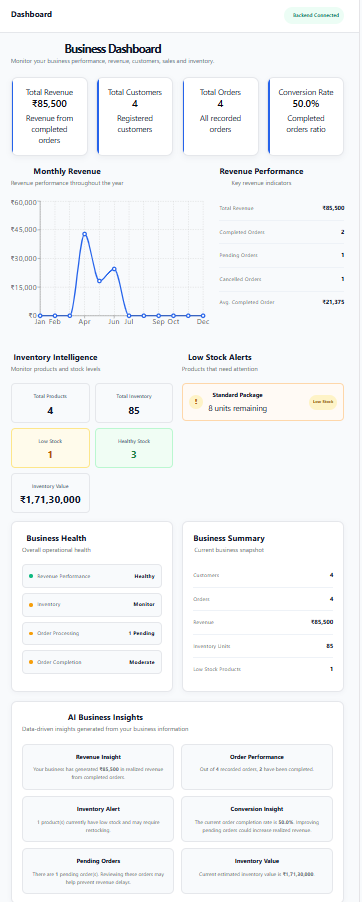
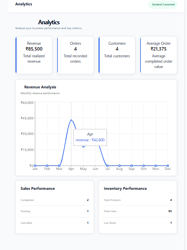
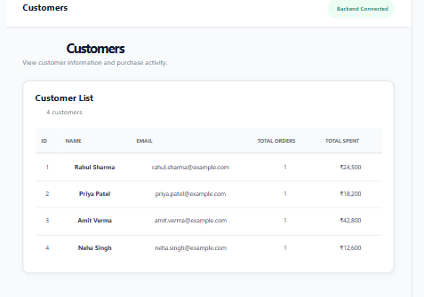
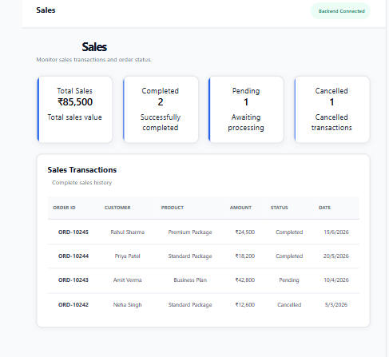
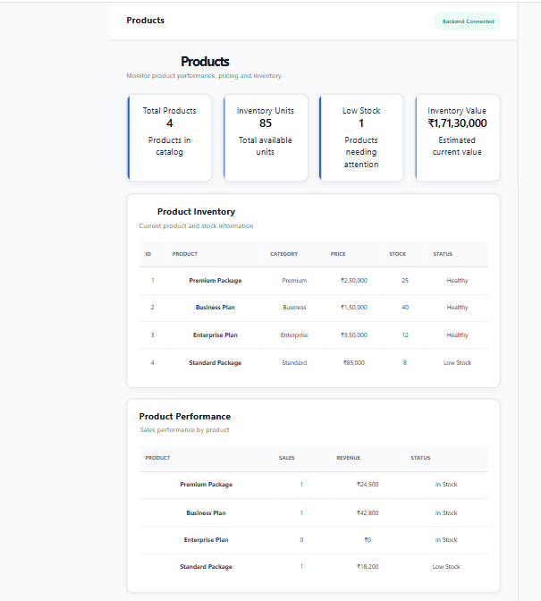

# AI Business Intelligence Platform

A full-stack business intelligence dashboard designed to help users monitor business performance, explore sales data, manage customer and product information, and view AI-powered business insights.

## Project Overview

The AI Business Intelligence Platform combines a React frontend with a FastAPI backend to provide a centralized interface for business analytics.

## Screenshots

### Dashboard


### Analytics


### Customer Management


### Sales


### Products and Inventory


### AI Insights


## Features

- Business dashboard and key performance indicators
- Analytics and revenue visualizations
- Customer information management
- Sales and order information
- Product and inventory views
- AI Insights interface
- REST API powered by FastAPI

## Technology Stack

**Frontend**
- React
- Vite
- JavaScript
- Recharts

**Backend**
- Python
- FastAPI
- Uvicorn
- SQLAlchemy

**Tools**
- Git and GitHub
- Visual Studio Code

## Project Structure

```text
AI-Buisness-Intelligence/
├── backend/
│   ├── main.py
│   ├── database/
│   └── requirements.txt
├── frontend/
│   ├── src/
│   ├── package.json
│   └── package-lock.json
├── docs/
│   └── screenshots/
├── data/
├── database/
├── .gitignore
└── README.md
```

## Getting Started

### Prerequisites

- Python installed
- Node.js and npm installed
- Git installed

### 1. Clone the repository

```bash
git clone https://github.com/Vbankar64/ai-business-intelligence-platform.git
cd ai-business-intelligence-platform
```

### 2. Set up the backend

```bash
cd backend
python -m venv venv
```

Activate the virtual environment on Windows:

```powershell
.\venv\Scripts\activate
```

Install the backend dependencies:

```bash
pip install -r requirements.txt
```

Start the backend:

```bash
python -m uvicorn main:app --reload --host 127.0.0.1 --port 8000
```

The API documentation is available at:

http://127.0.0.1:8000/docs

### 3. Set up the frontend

Open a second terminal:

```bash
cd frontend
npm install
npm run dev
```

Open the local URL displayed by Vite in your browser.

## API

The backend provides endpoints for health checks and business data. Available endpoints can be explored through the FastAPI documentation at `/docs`.

## Future Improvements

- Enhance AI-generated business recommendations
- Add data filtering and export options
- Improve authentication and access control
- Add automated tests
- Deploy the application for public access

## Author

Developed as a full-stack business intelligence and analytics portfolio project.

GitHub: https://github.com/Vbankar64